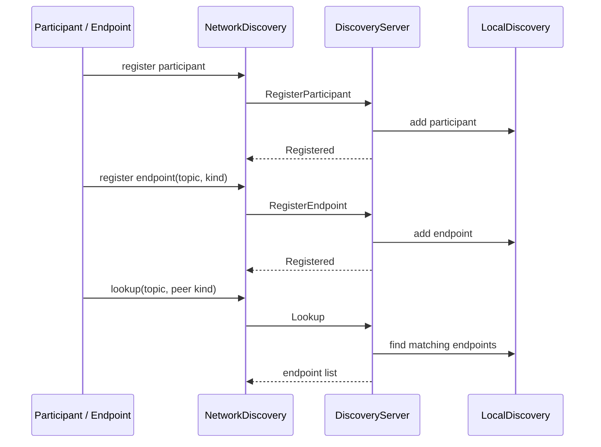
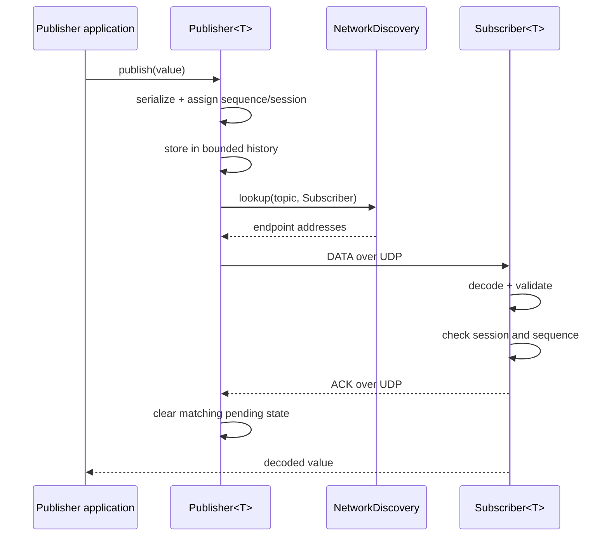
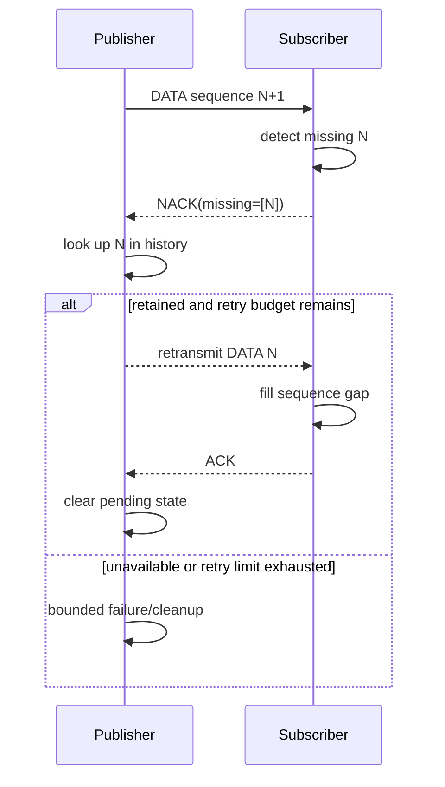
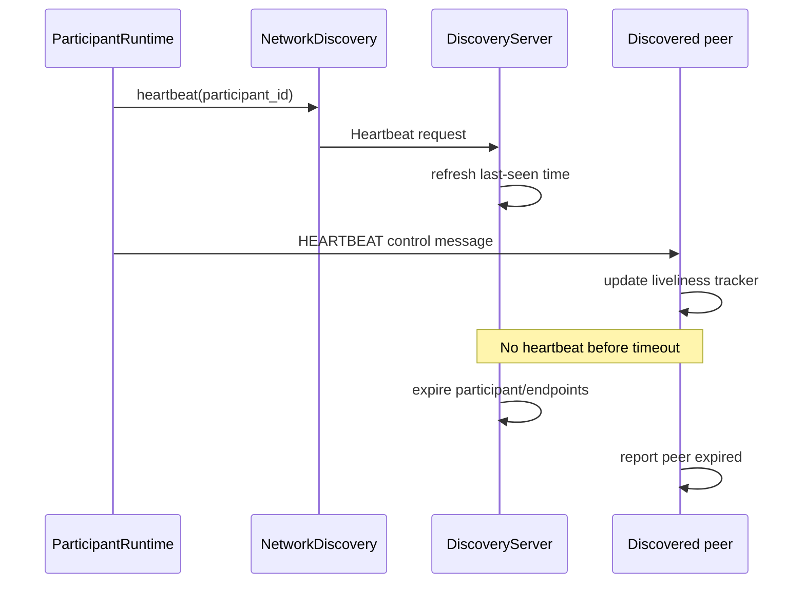

# Sequence diagrams

The Mermaid diagrams represent the current simplified protocol.

## Discovery and registration



## Publish and acknowledge



## Gap recovery



## Heartbeat and expiry



## Restart and delayed packets

```mermaid
sequenceDiagram
    participant Old as Publisher session A
    participant Sub as Subscriber
    participant New as Restarted session B
    Old->>Sub: DATA(session A, seq 8)
    Sub->>Sub: track session A
    New->>Sub: DATA(session B, seq 1)
    Sub->>Sub: retire A; activate B
    Old-->>Sub: delayed DATA(session A, seq 9)
    Sub->>Sub: reject retired session A
    New->>Sub: DATA(session B, seq 2)
    Sub->>Sub: advance session B tracker
```

## Notes

- Diagrams show conceptual ordering, not guaranteed timing or delivery.
- A line labeled UDP is a datagram; UDP does not guarantee arrival.
- See the [API reference](../API_REFERENCE.md) for exact signatures and wire fields.
